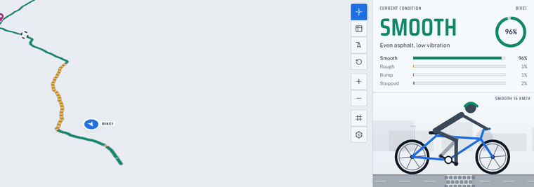
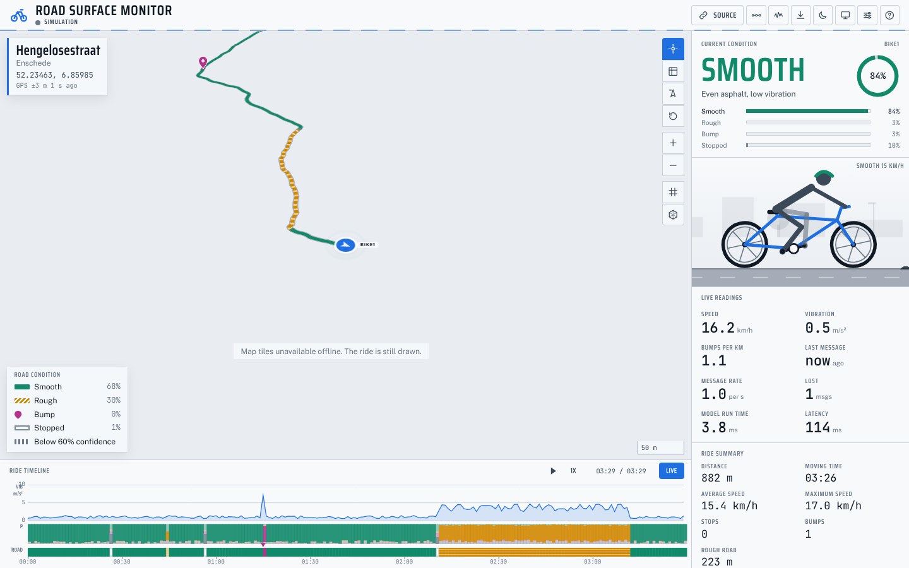

# Road Surface Monitor

A live dashboard for a bicycle-mounted road surface classifier. A Nordic Thingy:52 on the bike streams accelerometer data over Bluetooth Low Energy to a Raspberry Pi 5, which runs a classifier trained in Edge Impulse and publishes one label per window (smooth, rough, bump or stopped) with a confidence over MQTT. A phone on the rider supplies GPS through the OwnTracks app and a hotspot. HiveMQ Cloud carries the messages, and this dashboard, a static web page with no backend, subscribes over secure WebSockets and draws the ride on a map as it happens.

The dashboard starts in a simulation (a ride from the University of Twente campus to the Oude Markt along real streets) so there is always something on screen, switches to live data by itself when the first real classification arrives, can replay recorded logs, and exports what it has seen. It was built for the IoT course, University of Twente and is shown live on 6 November 2026.





## Features

Map and ride

- Condition-coloured route ribbon with a pattern per class (solid, hatched, pin, hollow), faint and dotted below the confidence threshold.
- Bump pins, a speed-adaptive follow camera, heading-up mode, overview, graticule, scale bar and cursor coordinates.
- Street name and GPS quality for the selected bike, with reverse geocoding kept within the Nominatim usage policy.
- Aggregated road quality as a hex grid across every ride seen in the session.

Readouts

- Current condition with confidence ring and class probabilities, an animated cyclist that reacts to the surface, live readings (speed, vibration, bumps per km, message age and rate, lost messages, model run time, latency) and a ride summary with a configurable comfort score.
- Ride timeline with vibration trace, probability bands, condition strip, hover link to the map and scrubbed playback at 1x to 10x.
- Area report per street, worst first, with map highlight.
- System pipeline view showing each message travelling through the four IoT components.

Data

- Tolerant data contract: seconds or milliseconds, confidence as 0 to 1 or 0 to 100, label aliases, several field spellings, OwnTracks positions.
- Three interchangeable sources: simulation, MQTT over WSS, and replay of `.jsonl` logs, all through the same parser and store.
- Exports: replayable `.jsonl` log, GeoJSON route, CSV of samples, PNG map snapshot.
- Raw IMU signal viewer for CSV files exported from Edge Impulse.

Presentation

- Light and dark themes, presentation mode with a larger type size, keyboard shortcuts, an opening sequence and reduced-motion support.
- Every setting adjustable in the browser without a rebuild, exportable as JSON.

## Quick start

Node 22 is required.

```sh
npm install
npm run dev        # http://localhost:5173
npm run build      # production build in dist/
npm run preview    # serve dist/ locally
npm test           # unit tests (Vitest)
npm run lint       # ESLint and Prettier
```

## Hosted version

The dashboard is published with GitHub Pages at `https://rishibala132004.github.io/road-surface-monitor/` from [https://github.com/rishibala132004/road-surface-monitor](https://github.com/rishibala132004/road-surface-monitor). One-time setting after the first push to `main`: repository Settings, Pages, set the source to "GitHub Actions". The workflow in `.github/workflows/pages.yml` builds with the repository name as the base path.

## Connecting real data

1. Create a HiveMQ Cloud cluster (free Serverless plan) and three credentials under Access Management: one for the dashboard, one for the Pi, one for the phone.
2. Install OwnTracks on the phone in MQTT mode, pointing at the cluster on port 8883 with TLS.
3. Start `publisher/publisher.py` on the Pi (or first in `--dummy` mode from a laptop) against port 8883.
4. In the dashboard, open Source (header), enter `wss://<cluster>.s1.eu.hivemq.cloud:8884/mqtt` and the dashboard credentials, and press Connect.
5. The dashboard switches from the simulation to live data when the first condition message arrives. Full steps are in [docs/MANUAL.md](docs/MANUAL.md).

## The Pi publisher

`publisher/publisher.py` provides the `RoadPublisher` class (automatic reconnect, offline queue, status thread) and a `--dummy` ride generator for testing without the bike. The Edge Impulse inference loop calls `pub.send(label, confidence, scores=..., vib=..., inference_ms=...)` once per window. See [publisher/README.md](publisher/README.md) for installation, environment variables and a systemd unit.

## Repository layout

```
.
├── public/
│   ├── config.json          deployed defaults, editable without a rebuild
│   ├── samples/demo-ride.jsonl  recorded ride for the backup replay
│   └── sim/route.geojson    simulator route (campus to Oude Markt)
├── src/
│   ├── config/              config types, loading, localStorage merge
│   ├── data/                contract (parser), store, GPS join, sources
│   ├── map/                 MapLibre set-up, layers, segments, geocoding
│   ├── components/          header, rail, timeline, drawers, overlays
│   ├── styles/              design tokens and component CSS
│   └── utils/               DOM, events, formatting, geometry, time
├── publisher/               Raspberry Pi side (Python, paho-mqtt)
├── tools/                   route and demo-ride generators
├── tests/                   Vitest unit tests
├── docs/                    manual, data contract, architecture, images
└── .github/workflows/       CI and GitHub Pages
```

## Documentation

- [docs/MANUAL.md](docs/MANUAL.md): team manual, from the screen tour to the demo-day checklist.
- [docs/DATA_CONTRACT.md](docs/DATA_CONTRACT.md): every MQTT message format, tolerance rules, join rules and export formats.
- [docs/ARCHITECTURE.md](docs/ARCHITECTURE.md): modules, data flow, the source switch and performance notes.
- [docs/CUSTOMISING.md](docs/CUSTOMISING.md): settings, `config.json`, design tokens, map styles, routes, classes.
- [docs/DECISIONS.md](docs/DECISIONS.md): short records of the main technical choices.
- [docs/PLACEHOLDERS.md](docs/PLACEHOLDERS.md): the `{{DOUBLE_BRACES}}` values the team fills in.
- [publisher/README.md](publisher/README.md): the Raspberry Pi publisher.
- [CONTRIBUTING.md](CONTRIBUTING.md) and [CHANGELOG.md](CHANGELOG.md).

## Licence

MIT, see [LICENSE](LICENSE). Map data from OpenStreetMap contributors, map styles by CARTO, street names from Nominatim, routing for the simulator route from the FOSSGIS OSRM server.

Rishi Bala S, Adarsh Nanjaiya Latha and team, IoT course, University of Twente
