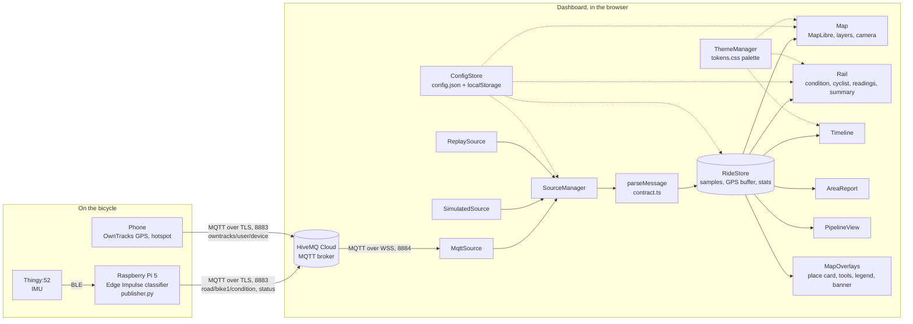
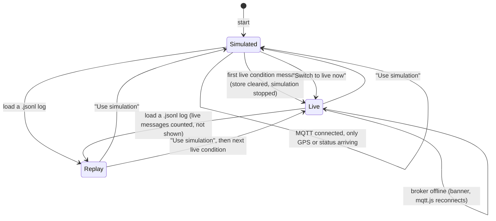

# Architecture

The system has four physical parts (sensor, Raspberry Pi, phone, browser) and one shared service (the MQTT broker). The dashboard is a static web page: plain TypeScript built with Vite, no framework and no backend. Everything the browser shows is computed from the messages it receives.

## System and data flow

The three sources emit identical raw `(topic, payload, receivedAt)` triples. `SourceManager` decides which source is allowed to feed the store, `parseMessage` normalises the payload (see [DATA_CONTRACT.md](DATA_CONTRACT.md)), and `RideStore.ingest` stores it and updates the statistics. Components read from the store; none of them keeps its own copy of the ride. `ConfigStore` broadcasts configuration changes to every part, and `ThemeManager` publishes the resolved palette for the canvas and WebGL parts that cannot read CSS variables.

## The four IoT components

| Component       | Block                                                                          | Where in this repository                                                                                       |
| --------------- | ------------------------------------------------------------------------------ | -------------------------------------------------------------------------------------------------------------- |
| Sensing         | Thingy:52 IMU; the phone's GPS                                                 | Sampling code on the Pi (`publisher/examples/edge_impulse_hook.py`, `read_imu_window`); OwnTracks on the phone |
| Data processing | Edge Impulse classifier on the Pi; the dashboard's parser, join and statistics | `publisher/`, `src/data/`                                                                                      |
| Connectivity    | BLE, the phone hotspot, MQTT over TLS and over WebSockets, HiveMQ Cloud        | `publisher/publisher.py` (paho-mqtt), `src/data/sources/MqttSource.ts` (mqtt.js)                               |
| User interface  | The dashboard                                                                  | `src/components/`, `src/map/`, `src/styles/`                                                                   |

The pipeline view (`src/components/pipeline.ts`, P) shows this same mapping on screen with live numbers per block.

## Source switching

Rules, as implemented in `SourceManager.handle` and `switchTo`:

- The app starts in simulation and the MQTT connection, when opened, listens alongside it. Only a parsed **condition** message from the live source triggers the switch; GPS-only traffic (a phone left running) does not. The store is cleared on every switch so a ride never mixes sources. The UI fades briefly and shows "Live data from bike1".
- Live never falls back to simulation on its own. A watchdog ticks every second; after `noDataTimeoutS` without a live message it raises the stale banner, which clears when data resumes.
- A replay replaces whatever is running. While it runs, live messages are counted in `ignoredLive` and discarded. Returning to live is manual: "Use simulation", after which the next live condition switches again.
- Messages from a source that is not the current one are dropped (a stopped source draining its last timer).
- `resetRide` clears the store without changing the source: the simulation restarts from the campus and a replay seeks to the start.

## Modules

| Path                                                           | Job                                                                                                                                                  |
| -------------------------------------------------------------- | ---------------------------------------------------------------------------------------------------------------------------------------------------- |
| `src/main.ts`                                                  | Boot: load config, build store, sources, map and components, wire events, run the frame loop, play the intro.                                        |
| `src/config/types.ts`                                          | `AppConfig` and its sub-types; the single description of every setting.                                                                              |
| `src/config/defaults.ts`                                       | Built-in copy of `public/config.json` for when the file cannot be fetched.                                                                           |
| `src/config/index.ts`                                          | `ConfigStore`: fetch `config.json`, apply `.env.local` overrides, merge localStorage settings, persist, emit changes.                                |
| `src/data/contract.ts`                                         | Message types and `parseMessage`: topic parsing, OwnTracks handling, aliases, tolerance rules.                                                       |
| `src/data/join.ts`                                             | `GpsBuffer`: sorted bounded buffer of fixes with interpolating `locate`.                                                                             |
| `src/data/store.ts`                                            | `RideStore`: devices, samples, raw records for export, derived statistics, time view for scrubbing.                                                  |
| `src/data/sources/DataSource.ts`                               | The common source interface and `BaseSource` plumbing.                                                                                               |
| `src/data/sources/SimulatedSource.ts`                          | `SimulatedRide` (pure, also used headless by the demo-ride tool) and the timer-driven browser source.                                                |
| `src/data/sources/MqttSource.ts`                               | mqtt.js over WebSockets, lazy-loaded, subscribe, reconnect with backoff, readable error messages.                                                    |
| `src/data/sources/ReplaySource.ts`                             | `parseJsonl` and a replayer with speed, pause and seek.                                                                                              |
| `src/data/sources/SourceManager.ts`                            | Routing between sources, the switch rules, the stale watchdog.                                                                                       |
| `src/map/map.ts`                                               | `MapController`: MapLibre set-up, theme styles with offline fallback, ride layers, markers, camera modes, graticule, hover, highlight, PNG snapshot. |
| `src/map/layers.ts`                                            | Pure GeoJSON builders: condition runs, bump points, hex grid.                                                                                        |
| `src/map/segments.ts`                                          | Pure functions splitting a ride into segments and grouping them by street.                                                                           |
| `src/map/geocode.ts`                                           | `Geocoder`: rate-limited, cached Nominatim reverse lookups with route-name fallback.                                                                 |
| `src/components/header.ts`                                     | Title, source chip, bike pills, tool buttons.                                                                                                        |
| `src/components/overlays.ts`                                   | Place card, GPS quality, map tools, legend, cursor coordinates, banners.                                                                             |
| `src/components/readouts.ts`                                   | The rail: current condition, probabilities, cyclist, live readings, summary, comfort, elevation, other bikes.                                        |
| `src/components/cyclist.ts`                                    | Canvas cyclist animation driven by label, speed and vibration.                                                                                       |
| `src/components/timeline.ts`                                   | Canvas timeline with hover, scrub and playback.                                                                                                      |
| `src/components/areaReport.ts`                                 | Street report and the hex aggregate across archived rides.                                                                                           |
| `src/components/pipeline.ts`                                   | Animated system diagram with live per-stage numbers.                                                                                                 |
| `src/components/settings.ts`                                   | Settings drawer bound to `ConfigStore`.                                                                                                              |
| `src/components/connect.ts`                                    | Source drawer: MQTT credentials, simulator controls, replay loading and controls.                                                                    |
| `src/components/exports.ts`                                    | `.jsonl`, GeoJSON, CSV and PNG exports.                                                                                                              |
| `src/components/rawSignal.ts`                                  | CSV parser and plots for Edge Impulse IMU exports.                                                                                                   |
| `src/components/shortcuts.ts`                                  | Keyboard shortcuts and the help drawer.                                                                                                              |
| `src/components/theme.ts`                                      | Theme setting, accent and class colour overrides, palette read back from CSS.                                                                        |
| `src/components/intro.ts`, `drawer.ts`, `toast.ts`, `icons.ts` | Opening sequence, drawer container, toasts, inline SVG icons.                                                                                        |
| `src/styles/tokens.css`                                        | Every design value, light and dark.                                                                                                                  |
| `src/styles/*.css`                                             | Base, layout, map, rail, cyclist, timeline and chrome (drawers, header) styles, tokens only.                                                         |
| `src/utils/`                                                   | `dom.ts` (`el` helper, downloads), `events.ts` (typed emitter), `format.ts`, `geo.ts` (haversine, polyline, hex maths), `time.ts`.                   |
| `tests/`                                                       | Vitest: contract parsing, GPS join, store statistics, simulator output and route.                                                                    |
| `tools/make-route.mjs`                                         | Builds the simulator route from OSRM with street names.                                                                                              |
| `tools/make-demo-ride.mjs`                                     | Records a simulated ride to `public/samples/demo-ride.jsonl`.                                                                                        |
| `publisher/publisher.py`                                       | `RoadPublisher` (reconnect, QoS 1 conditions, offline queue, status thread) and the `--dummy` generator.                                             |
| `publisher/gps_bridge.py`                                      | Optional GPS from gpsd or NMEA when no phone is used.                                                                                                |
| `publisher/examples/edge_impulse_hook.py`                      | Reference Edge Impulse Linux SDK loop calling the publisher.                                                                                         |

## The frame loop and throttles

`main.ts` runs one `requestAnimationFrame` loop. Each frame calls, in order, `map.frame`, `rail.frame`, `timeline.frame`, `overlays.frame`, `report.frame` and `pipeline.frame` with the current time. Continuous things (marker easing between GPS fixes, the cyclist, playback of a scrub) happen every frame; everything else is throttled inside the component:

| Work                                      | Rate                                                                                  | Where                   |
| ----------------------------------------- | ------------------------------------------------------------------------------------- | ----------------------- |
| Rebuilding the map GeoJSON from the store | At most every 250 ms, and only when marked dirty                                      | `MapController.refresh` |
| Live readings and summary numbers         | 4 Hz (every 250 ms); each number changes at most four times a second                  | `Rail.frame`, `Roller`  |
| Place card, GPS quality, legend shares    | Every 300 ms                                                                          | `MapOverlays.frame`     |
| Area report rebuild                       | Every 5 s, and only when the sample count changed                                     | `AreaReport.frame`      |
| Reverse geocoding                         | One request per `minIntervalMs` (1100 ms), cached on a 40 m grid, live position first | `Geocoder`              |
| Timeline redraw                           | Only when the sample count, width, view, theme or hover changed                       | `Timeline.frame`        |
| Elevation profile                         | Every 2 s                                                                             | `Rail.renderNumbers`    |
| Stale watchdog                            | Every 1 s                                                                             | `SourceManager`         |

## Performance notes

- Sample arrays are append-only and capped at 20 000 per bike (GPS fixes likewise); the oldest are dropped. Raw records for export are capped at 200 000.
- Statistics are incremental where it matters: label counts and metres per label are running counters, distance walks forward from the last sample, the message rate uses a sliding 10 s window. `recomputeStats` still scans the sample list for moving time, stops and maximum speed, which is cheap at one sample per second.
- `sampleAt` and `GpsBuffer.locate` use binary search, so scrubbing and joining do not degrade over a long ride.
- Canvas parts (timeline, cyclist road, elevation) redraw only when their inputs change or on interaction; the map pushes new GeoJSON only when dirty.
- mqtt.js and MapLibre are split into their own chunks by `vite.config.ts`; mqtt.js is imported lazily on the first connect so a simulation-only start does not load it.
- Fonts are self-hosted through `@fontsource` so the typography does not depend on the network.

## Deployment

`.github/workflows/ci.yml` runs on every push and pull request: `npm run lint`, `npm run typecheck`, `npm test`, `npm run build`, and a `py_compile` of the Python files.

`.github/workflows/pages.yml` runs on pushes to `main`: it builds with `VITE_BASE=/<repo>/` (or `/` for a `<user>.github.io` repository) so that `config.json`, the route and the demo ride resolve under the project path, uploads `dist/` and deploys it with `actions/deploy-pages`. The repository setting "Pages, source: GitHub Actions" has to be set once. `vite.config.ts` reads `VITE_BASE` and defaults to `/`, so a local build works on any static host.

Because the page is served over https, the broker must be reached over `wss://` (HiveMQ Cloud port 8884). The Pi and the phone use MQTT over TLS on 8883; the two ports are the only difference between the paths.
