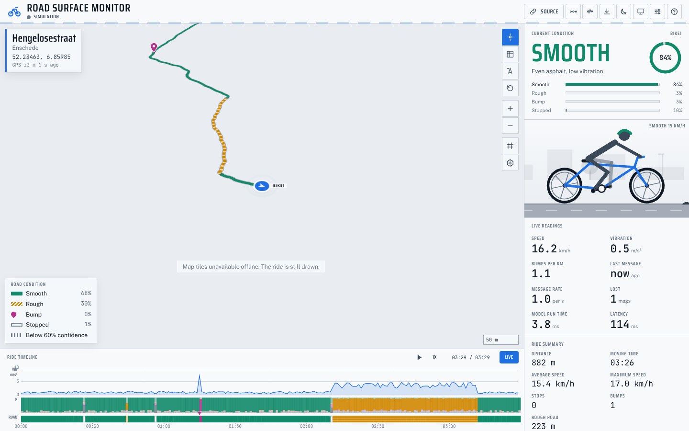
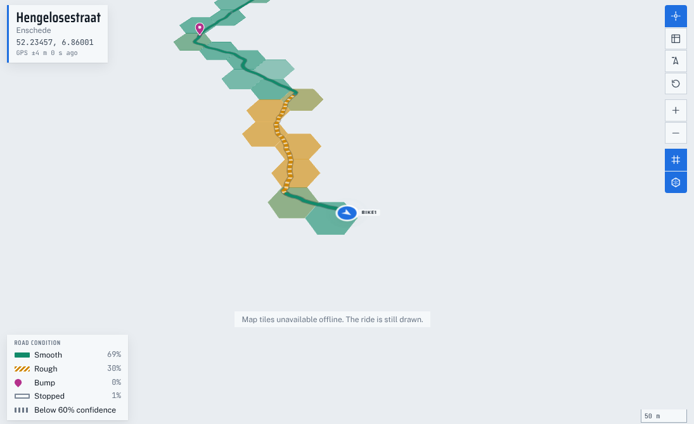
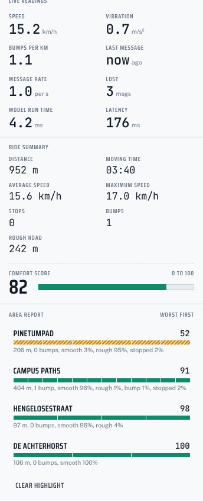
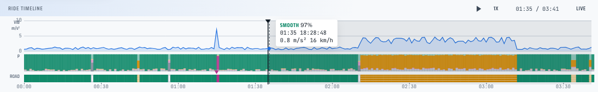
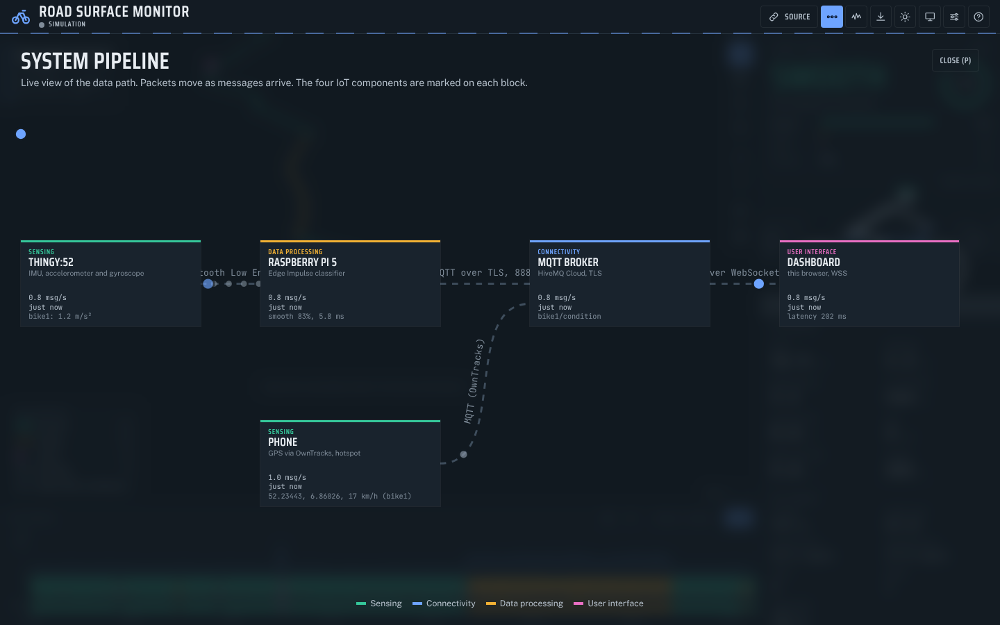
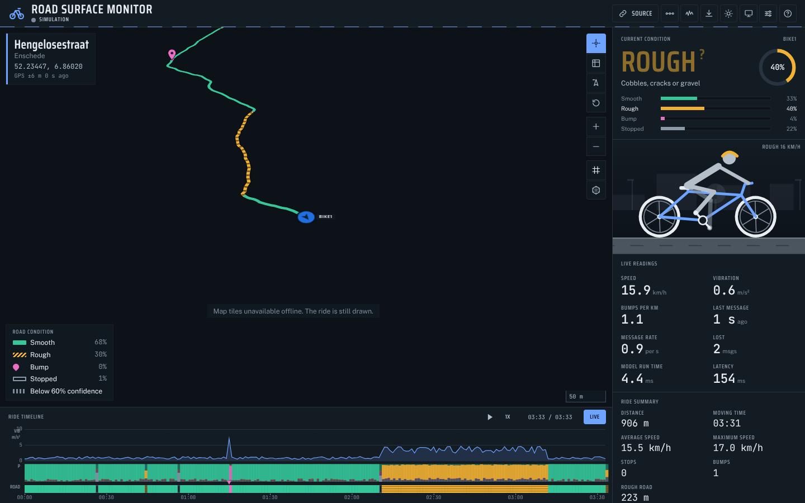
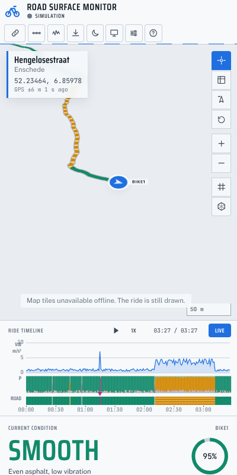
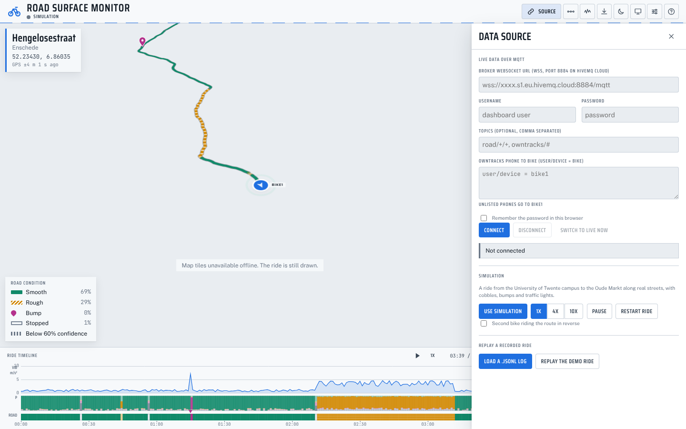
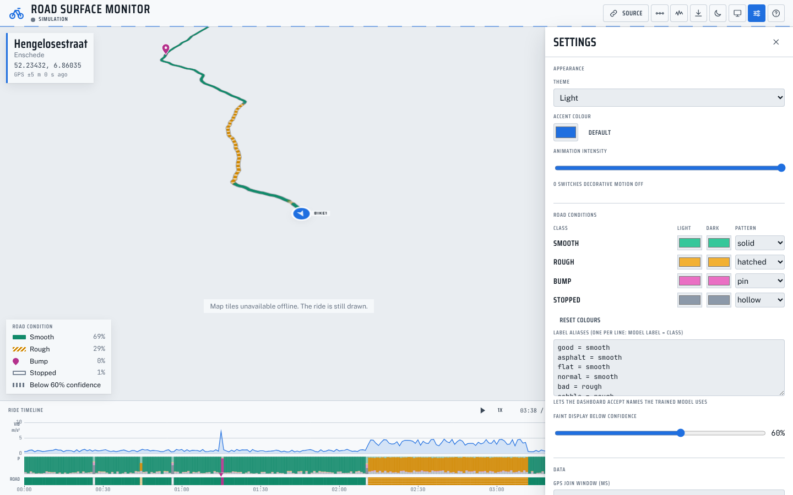

# Team manual

This is the manual for the team: it assumes you know the Thingy:52, the Raspberry Pi and Python, but have not looked at the dashboard code. It goes from what is on the screen, through running the dashboard and connecting the real bike, to the demo-day checklist and troubleshooting.

Note on the screenshots: they were taken offline, so the map background is a plain colour with the note "Map tiles unavailable offline". With an internet connection the CARTO base map (Positron in the light theme, Dark Matter in the dark theme) appears underneath the ride.

Contents

1. [What the dashboard shows](#1-what-the-dashboard-shows)
2. [Running it](#2-running-it)
3. [Simulation mode](#3-simulation-mode)
4. [Connecting real data](#4-connecting-real-data)
5. [The data contract in short](#5-the-data-contract-in-short)
6. [Demo-day checklist](#6-demo-day-checklist)
7. [Troubleshooting](#7-troubleshooting)
8. [Customising](#8-customising)
9. [Contributing](#9-contributing)

## 1. What the dashboard shows



The screen has four regions: the header across the top, the map filling the left, the rail down the right, and the timeline along the bottom.

**Header.** From left to right: the project title with a source chip under it that reads Simulation, Live or Replay (with a short detail such as "broker connected, waiting for the first result"); bike pills to select a bike when more than one is present; the Source button that opens the data source drawer and turns active when the broker is connected; then icon buttons for the system pipeline view (P), the raw IMU signal viewer, Export, theme switch (T), presentation mode (F for full screen), Settings and the shortcut list (?).

**Place card, top-left of the map.** The street the selected bike is on, the area under it, the coordinates, and a GPS quality line: accuracy in metres, the age of the last fix and whether the position was interpolated between two fixes. The line turns to the "poor" colour when the accuracy is worse than 15 m or the last fix is older than 5 s. Street names come from Nominatim while online and from the names baked into the simulator route when offline.

**Map tools, top-right of the map.** Follow the bike (the camera tracks the selected bike and zooms in when it slows down), Overview (fit the whole ride, also O), heading-up or north-up, Reset the view, zoom in and out, the latitude and longitude grid, and the hex layer showing aggregated road quality from every ride seen in the session.



**Legend, bottom-left of the map.** One row per class with its colour and pattern and the share of windows in that class, plus a row for the low-confidence style. The map ribbon uses a pattern as well as a colour so nobody has to rely on colour alone: solid for smooth, hatched for rough, a pin for a bump, hollow (an inner line in the background colour) for stopped, and faint with a dotted overlay for any window below the confidence threshold (60% by default). The same patterns are used on the timeline strip. Next to the legend the cursor coordinates appear when the pointer is over the map, and a MapLibre scale bar sits in the map corner.

**Rail, right.** Top to bottom:

- Current condition: the class name and its hint, a confidence ring with the percentage, and the probability bars for every class (the winning class is marked). If the label is not in the class list, the raw label is shown with the hint "Label not in the class list: add an alias in settings".
- The cyclist: pedals and wheels turn with speed, the figure shakes on rough road, jolts on a bump and puts a foot down when stopped. The road surface scrolls underneath in the current condition's colour.
- Live readings, eight tiles:
  - Speed: from the joined GPS position, km/h (or m/s in settings).
  - Vibration: RMS acceleration in m/s^2 from the message; "est." when the message had none and the class default is shown.
  - Bumps per km: bump events divided by distance (shown once the ride is over 50 m).
  - Last message: time since the last condition message was received ("scrubbing" while you are looking back in the timeline).
  - Message rate: condition messages per second over the last 10 s.
  - Lost: messages missing from the `seq` counter, that is, gaps in the sequence numbers.
  - Model run time: `inference_ms` from the last message, the time the classifier took on the Pi.
  - Latency: receipt time minus the message `ts`, in ms. This only means something when the Pi's clock is right.
- Ride summary: distance, moving time, average and maximum speed, stops, bumps, metres of rough road, and the comfort score (0 to 100) with a bar. Hover over the comfort block to see the formula with the current weights. An elevation profile appears below when the GPS source reports altitude.
- Other bikes: small cyclists with distance, bumps and comfort for every bike other than the selected one. Click one to select it.
- Area report: the ride split into 25 m segments, grouped by street, worst first, each with a condition strip, metres, bumps and comfort. Click a street to highlight and frame it on the map; "Clear highlight" removes it.



**Timeline, bottom.** Three bands: the vibration trace, the class probabilities as stacked bands, and the condition strip with bump pins and stops, over a time axis in mm:ss. Hover to see a tooltip (class, confidence, time, vibration, speed) and a ghost marker at that point on the map. Click or drag to scrub: the whole dashboard, including the map ribbon and the readouts, shows the ride as it was at that moment. The controls on the right are play/pause (Space), the speed button cycling 1x, 2x, 5x and 10x, the clock (position / ride length) and Live, which returns to the newest data. Escape also returns to live.



**Pipeline view (P).** A live diagram of the system: Thingy:52, Raspberry Pi 5, MQTT broker, Dashboard and Phone, each tagged with its IoT component (sensing, data processing, connectivity, user interface). Every message animates as a packet along its link, and each block shows live numbers.



The dark theme is available from the header or with T:



On a narrow screen (under 900 px) the layout stacks: the map on top, then the timeline, then the rail, and the page scrolls:



## 2. Running it

The hosted version is at `https://<org>.github.io/<repo>/` (built from [{{GITHUB_REPO_URL}}]({{GITHUB_REPO_URL}}) on every push to `main`). Nothing needs installing to use it.

To run it locally:

1. Install Node 22.
2. In the repository root run `npm install`.
3. Run `npm run dev` and open `http://localhost:5173`.

To build the static site run `npm run build`; the result is in `dist/` and can be served from any static web server. `npm run preview` serves that folder locally for a check before pushing.

The opening sequence (title card, then the camera flies down onto the bike) plays once per browser session. Add `?nointro` to the URL to skip it, for example `http://localhost:5173/?nointro`. Click or press any key to skip it while it plays.

## 3. Simulation mode

The dashboard always starts in simulation so the screen is never empty. The source chip in the header says Simulation. What is simulated:

- A ride along `public/sim/route.geojson`, real streets from the University of Twente campus via the Hengelosestraat to the Oude Markt (about 4 km). At the Oude Markt the rider turns round and rides back.
- Four rough sections (a campus gravel path, a patched stretch of the Hengelosestraat, cobbles in the centre), eight bumps of which two pairs are close together like the two edges of a speed bump, and three traffic-light stops of 9 to 14 s.
- Speeds of 15 to 19 km/h on smooth road and 11 to 14 km/h on rough road, with gentle braking before stops.
- GPS noise of 3 to 6 m that drifts slowly, reported as the `acc` value.
- Model mistakes in about 4% of windows, always with a low confidence (34 to 58%), so the faint and dotted low-confidence style shows up. Correct windows have confidences between 66 and 99% depending on the class.
- One condition message and one GPS fix per simulated second per bike, a status message every 10 s, and about 1% of condition messages dropped so the Lost counter moves.
- The first 200 s are generated instantly at start, back-dated, so there is a ride on the map straight away.

Controls, in the Source drawer (header, Source):



- 1x, 4x and 10x set the simulation speed.
- Pause and Resume.
- Restart ride starts again from the campus.
- Second bike adds `bike2` riding the route in reverse, so the bike pills and the "Other bikes" section appear.
- Use simulation returns to the simulation after a live or replay session.

Keyboard: Space pauses and resumes the simulation (when the timeline is live), R resets the ride, 1 to 4 select a bike.

## 4. Connecting real data

Three parties talk to the broker: the Pi publishes classifications, the phone publishes positions, and the dashboard subscribes to both. The dashboard keeps running the simulation until the first real condition message arrives, then switches by itself.

### 4.1 Create the HiveMQ Cloud cluster and users

1. Sign up at HiveMQ Cloud and create a cluster on the free Serverless plan. Note the cluster hostname, of the form `xxxx.s1.eu.hivemq.cloud`.
2. Open Access Management and create three credentials:
   - a dashboard user with subscribe permission on `{{TOPIC_PREFIX}}/#` and `owntracks/#`;
   - a Pi user with publish permission on `{{TOPIC_PREFIX}}/#`;
   - a phone user with publish permission on `owntracks/#`.
     A single user with publish and subscribe on both patterns also works for a first test.
3. Note the two addresses the system uses. The Pi and the phone use MQTT over TLS on port 8883, host `{{BROKER_HOST}}`. The dashboard uses MQTT over secure WebSockets on port 8884: `wss://<cluster>.s1.eu.hivemq.cloud:8884/mqtt`. HiveMQ Cloud accepts nothing unencrypted.

### 4.2 Set up OwnTracks on the phone

1. Install OwnTracks (Android or iOS).
2. In its preferences choose the MQTT mode (not HTTP).
3. Host: the cluster hostname. Port: 8883. TLS: on. Username and password: the phone user from 4.1.
4. Set a device ID and a tracker ID (two letters). The device ID becomes the last part of the topic `owntracks/<username>/<deviceid>`.
5. Set the monitoring mode to "Move" so the phone reports continuously while riding rather than only on significant changes.
6. In the dashboard's Source drawer, under "OwnTracks phone to bike", enter one line per phone of the form `user/device = bike1` (the `owntracks/` prefix may be left out). Phones that are not listed are assigned to the default bike (`bike1`, `broker.owntracksDefaultBike` in `config.json`), so with one bike and one phone this step can be skipped.

### 4.3 Run the publisher on the Pi in dummy mode

Do this once from a laptop and once from the Pi over the hotspot; it proves the broker, the credentials and the dashboard before the classifier is involved.

```sh
cd publisher
python3 -m venv .venv
source .venv/bin/activate
pip install -r requirements.txt
python3 publisher.py --host {{BROKER_HOST}} --user pi --password '...' --device bike1 --dummy
```

Or with environment variables, which keeps the password out of the shell history:

```sh
export ROAD_MQTT_HOST={{BROKER_HOST}}
export ROAD_MQTT_USER=pi
export ROAD_MQTT_PASSWORD='...'
python3 publisher.py --dummy --with-gps
```

`--with-gps` also publishes a fake track in Enschede so the bike moves without a phone. `--verbose` prints every message.

With the dashboard connected (4.5), the first dummy condition message makes the simulation fade out, a toast says "Live data from bike1", the chip in the header says Live, and the ride starts again from nothing. Stop the publisher with Ctrl-C before the real ride, otherwise the dummy data and the real data would both land on `bike1`.

### 4.4 Hook the publisher into the Edge Impulse inference script

`publisher/examples/edge_impulse_hook.py` is a complete loop around the Edge Impulse Linux SDK; the only function to replace is `read_imu_window()`, which must return the Thingy:52 accelerometer window. To add the publisher to an existing script instead:

```python
from publisher import RoadPublisher

pub = RoadPublisher(host, username=user, password=password, device="bike1", model_name="road-v3")

# after each classification:
scores = res["result"]["classification"]        # label -> probability
label = max(scores, key=scores.get)
pub.send(label, confidence=scores[label], scores=scores, vib=vib, inference_ms=ms)

# when the script ends (in a finally block):
pub.close()
```

`send` fills in `ts` (milliseconds) and an incrementing `seq`, publishes with QoS 1 and queues up to 5000 messages while the connection is down. A status message goes out every 10 s on its own thread.

Make sure the label names the model outputs match `{{LABELS}}` (smooth, rough, bump, stopped). Matching is case-insensitive and goes through an alias table, so `good`, `cobbles`, `pothole` and `idle` already work. If the model uses other names, either add them in the settings drawer under "Label aliases" (one line per alias, `model label = class`) or in `aliases` in `public/config.json`. Unknown labels are not dropped: they appear in the condition panel with the raw name and a hint to add an alias, so you will notice.

### 4.5 Connect the dashboard and do a test ride

1. Open the dashboard and click Source in the header.
2. Enter the WebSocket URL (`wss://<cluster>.s1.eu.hivemq.cloud:8884/mqtt`), the dashboard username and password. The Topics field can stay empty; the dashboard then subscribes to `{{TOPIC_PREFIX}}/+/+`, `{{TOPIC_PREFIX}}/+/+/+` and `owntracks/#`.
3. Tick "Remember the password in this browser" if this browser will be used on demo day; the dashboard then reconnects by itself on the next load. The credentials never leave the browser.
4. Click Connect. The status line under the buttons goes through Connecting, then "Connected: Subscribed to ...". While the simulation is still running, the header chip detail reads "broker connected, waiting for the first result".
5. Start OwnTracks on the phone and the publisher on the Pi, and ride a short loop.

What to watch for:

- The switch to live happens on the first condition message, not on GPS. If only the phone is sending, the simulation keeps running; "Switch to live now" in the Source drawer forces the switch.
- GPS join: a condition is drawn on the map only when a GPS fix lies within the join window (3 s by default) of its timestamp. Conditions without a position still update the readouts, the counters and the timeline. If the readings move but the map does not, look at the GPS quality line under the coordinates in the place card: "none" means no fix has arrived for this bike, a large age means the phone has stopped reporting, and a large accuracy means a poor fix.
- The Lost tile should stay at 0 or move slowly; a jump means the hotspot dropped and the publisher queued messages, which arrive in a burst afterwards.
- Latency should be in the hundreds of milliseconds. Seconds or negative-looking values mean the Pi's clock is off (see troubleshooting).

## 5. The data contract in short

| Topic                               | From  | Content                          |
| ----------------------------------- | ----- | -------------------------------- |
| `{{TOPIC_PREFIX}}/<bike>/condition` | Pi    | One classified window            |
| `{{TOPIC_PREFIX}}/<bike>/gps`       | Pi    | Position, only if the Pi has GPS |
| `{{TOPIC_PREFIX}}/<bike>/status`    | Pi    | Health, every 10 s               |
| `owntracks/<user>/<device>`         | Phone | OwnTracks location               |

A condition message:

```json
{
  "v": 1,
  "device": "bike1",
  "label": "rough",
  "confidence": 0.91,
  "ts": 1793290000000,
  "scores": { "smooth": 0.05, "rough": 0.91, "bump": 0.03, "stopped": 0.01 },
  "vib": 3.2,
  "inference_ms": 4.1,
  "seq": 1532
}
```

Only `label` is required. The device falls back to the topic, `ts` to the receipt time and `confidence` to 1. The parser accepts `ts` in seconds or milliseconds, confidence as 0 to 1, 0 to 100 or "87%", labels in any case and through aliases, and a number of alternative field names (`latitude`, `lng`, `timestamp`, `conf`, `classification`, `vibration`, and so on). Unknown fields are ignored and unknown labels are kept and flagged. The full tables, the join rules and the export formats are in [DATA_CONTRACT.md](DATA_CONTRACT.md).

## 6. Demo-day checklist

Friday 6 November 2026, on the projector.

- Charge everything the evening before: Thingy:52, the Pi's power bank, the phone, the laptop.
- Phone hotspot on, the Pi connected to it and showing the right time (`timedatectl` on the Pi).
- Broker reachable: run `publisher.py --dummy` from a laptop and see it arrive on the dashboard, then stop it.
- Open the dashboard on the presentation laptop before the talk starts and connect it (or let the remembered connection reconnect). Check the header chip detail says the broker is connected.
- Theme chosen for the room (dark usually projects better), presentation mode on (header button, or F for full screen with presentation mode).
- Press R (Reset ride) when the rider sets off so the ride summary starts from zero.
- Keep the Source drawer and the pipeline view (P) ready; the pipeline view is a good way to explain the four IoT components while the rider gets going.
- After the ride, Export the log (.jsonl) so the ride can be replayed and attached to the report.
- Backup: if the live link fails, open the Source drawer and click "Replay the demo ride" (bundled) or "Load a .jsonl log" with a recording from a test ride. A replay replaces whatever is running and ignores live messages while it runs.
- Know the shortcuts:

| Key    | Action                                         |
| ------ | ---------------------------------------------- |
| F      | Full screen (with presentation mode)           |
| T      | Switch theme                                   |
| P      | System pipeline view                           |
| O      | Overview: fit the whole ride                   |
| Space  | Play or pause the replay or simulation         |
| R      | Reset the ride                                 |
| 1 to 4 | Select a bike                                  |
| ?      | Shortcut list                                  |
| Esc    | Close panels, then return the timeline to live |

## 7. Troubleshooting

**No messages arriving.** Check in this order: the Source drawer status line says Connected; the publisher prints "online" rather than "offline, N queued"; both use the same topic prefix (`road` unless changed) and the same cluster. Test with `publisher.py --dummy --verbose` from the laptop the dashboard runs on, which removes the hotspot from the equation.

**Wrong port.** The Pi and the phone use 8883 (MQTT over TLS). The browser uses 8884 (MQTT over WebSockets, `wss://...:8884/mqtt`). The Source drawer refuses URLs that do not start with `ws://` or `wss://`, and mqtt.js reports "WebSocket failed: check the URL (wss://host:8884/mqtt) and TLS" when the port is wrong.

**TLS errors on the Pi** (`ssl.SSLCertVerificationError`). The CA store is out of date: `sudo apt update && sudo apt install --reinstall ca-certificates`. Do not disable certificate checking.

**Login refused.** "Login refused: check username and password" in the dashboard, or "Not authorized" on the Pi: wrong credentials, or the HiveMQ credential lacks the right permission (subscribe for the dashboard, publish for the Pi and phone).

**Labels showing as unknown.** The model's label names do not match the class list. Add aliases in the settings drawer ("Label aliases") or in `config.json`, or rename them in `LABEL_ALIASES` in the hook script.

**No map tiles.** The style could not be fetched (no internet, or a captive portal). After about eight seconds the map falls back to a plain background with the note "Map tiles unavailable offline"; the ride is still drawn. Reload once the network is back.

**GPS not attached (readings move, map does not).** The condition and the fix must be within the join window (3 s default, settings drawer "GPS join window"; widen it to 5000 or 10000 ms if the phone reports less often). Both clocks must be right: the Pi has no battery-backed clock and only syncs over the network, so the hotspot must be up before the publisher starts (`timedatectl`, or `sudo systemctl restart systemd-timesyncd`). OwnTracks `tst` comes from the phone's clock, which is normally correct. Also check the OwnTracks mapping: a phone mapped to the wrong bike draws nothing for `bike1`.

**Lost messages climbing.** Hotspot dropouts. The publisher queues (up to 5000) and flushes in order on reconnect, and conditions use QoS 1, so the data is not actually lost; the counter reflects gaps at the moment of receipt and messages that arrive later in a burst. If the counter jumps by thousands at once the publisher restarted with a fresh `seq`; gaps of 10 000 or more are ignored for that reason.

**"No data for N s" banner.** No live message for longer than `noDataTimeoutS` (20 s by default). The dashboard stays in live mode and never falls back to the simulation on its own; the banner disappears when data resumes. If the broker connection itself drops, the banner reads "Broker offline, reconnecting" and mqtt.js reconnects with an increasing delay up to 30 s.

**Page served over https cannot use ws://.** A GitHub Pages site is https, and browsers block unencrypted WebSockets from it. Use `wss://` (HiveMQ Cloud port 8884). A local Mosquitto with `ws://localhost:9001` works only from `npm run dev` over http.

**Replay ignores live messages.** While a replay runs, incoming live messages are counted ("N live messages ignored during replay" in the Source drawer) but not shown. To get back to live data click "Use simulation" in the Source drawer; the broker connection is still open, and the next live condition message switches the dashboard to live again.

**Settings look wrong after someone changed them.** Settings drawer, "Reset to defaults" returns to `public/config.json`. User changes live in this browser only.

## 8. Customising

Most of the look and behaviour can be changed in the browser. The settings drawer (header, Settings) has these sections:



- Appearance: theme (system, light, dark), accent colour, animation intensity (0 switches decorative motion off).
- Road conditions: per class a light colour, a dark colour and a pattern; Reset colours; label aliases; the confidence threshold below which samples are drawn faint.
- Data: GPS join window (ms), no-data warning delay (s), area report segment length (m).
- Comfort score: smooth weight, rough weight, points per bump per km.
- Units: speed in km/h or m/s, coordinates as decimal degrees or degrees, minutes, seconds.
- Map: light and dark style URLs, street names from Nominatim on or off.
- Simulator: speed, second bike, model error rate.
- Settings file: Export JSON, Import JSON, Reset to defaults.

Where the values come from: `public/config.json` holds the deployed defaults and can be edited without a rebuild (it is fetched at start). Changes made in the settings drawer are stored in this browser's localStorage under `rsm.settings.v1` and merged on top, key by key, so editing `config.json` later still applies to anything the user did not touch. Export JSON writes only the changed keys; Import JSON replaces them; Reset clears them.

Colours, fonts, spacing, radii and motion are defined once in `src/styles/tokens.css` for the light theme and once for the dark theme. Components only reference those custom properties.

Where each feature lives in the code:

| Feature                                  | File                                        |
| ---------------------------------------- | ------------------------------------------- |
| Message parsing, aliases, topic rules    | `src/data/contract.ts`                      |
| GPS join                                 | `src/data/join.ts`                          |
| Ride store, statistics, comfort score    | `src/data/store.ts`                         |
| Simulation                               | `src/data/sources/SimulatedSource.ts`       |
| MQTT connection                          | `src/data/sources/MqttSource.ts`            |
| Log replay                               | `src/data/sources/ReplaySource.ts`          |
| Source switching, stale watchdog         | `src/data/sources/SourceManager.ts`         |
| Config types and defaults                | `src/config/types.ts`, `public/config.json` |
| Config loading and localStorage          | `src/config/index.ts`                       |
| Map, camera, layers                      | `src/map/map.ts`, `src/map/layers.ts`       |
| Street segments for the area report      | `src/map/segments.ts`                       |
| Reverse geocoding                        | `src/map/geocode.ts`                        |
| Header                                   | `src/components/header.ts`                  |
| Place card, map tools, legend, banner    | `src/components/overlays.ts`                |
| Rail: condition, readings, summary       | `src/components/readouts.ts`                |
| Cyclist animation                        | `src/components/cyclist.ts`                 |
| Timeline                                 | `src/components/timeline.ts`                |
| Area report, hex aggregate               | `src/components/areaReport.ts`              |
| Pipeline view                            | `src/components/pipeline.ts`                |
| Settings drawer                          | `src/components/settings.ts`                |
| Source drawer (MQTT, simulation, replay) | `src/components/connect.ts`                 |
| Exports                                  | `src/components/exports.ts`                 |
| Raw IMU signal viewer                    | `src/components/rawSignal.ts`               |
| Keyboard shortcuts and help              | `src/components/shortcuts.ts`               |
| Theme and palette                        | `src/components/theme.ts`                   |
| Opening sequence                         | `src/components/intro.ts`                   |
| Design tokens                            | `src/styles/tokens.css`                     |
| Pi publisher                             | `publisher/publisher.py`                    |

Everything else, including map styles, the simulator route, adding a class or a reading, is in [CUSTOMISING.md](CUSTOMISING.md).

## 9. Contributing

`main` is always deployable; every push to it is published to GitHub Pages. Work on a branch named after the change, open a pull request, and have one teammate review it. Before pushing run `npm run lint`, `npm run typecheck`, `npm test` and `npm run build`; CI runs the same four commands plus a syntax check of the Python files. The full rules are in [CONTRIBUTING.md](../CONTRIBUTING.md), and the reasons behind the main technical choices are in [DECISIONS.md](DECISIONS.md).
